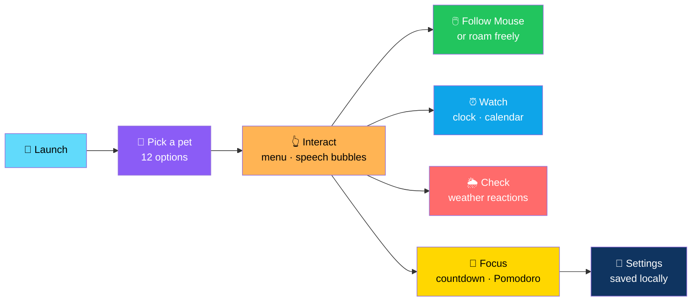
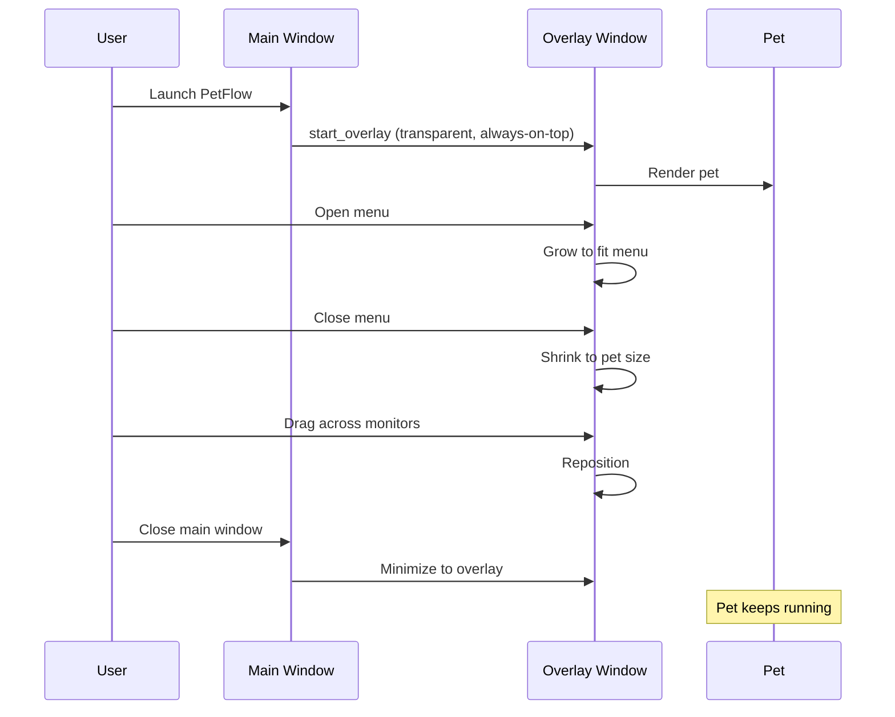

# 🐾 PetFlow — A Little Friend While You Work

<div align="center">


**A little friend while you work.**

*A virtual pet companion for the web and Windows desktop.*

[✨ Features](#-features) • [🚀 Web Development](#-web-development) • [🖥️ Windows Desktop Build](#️-windows-desktop-build) • [🔮 How the Overlay Works](#-how-the-desktop-overlay-works) • [📁 Structure](#-structure)

</div>

---

## 📖 Overview

**PetFlow** is a **virtual pet companion** for the **web** and **Windows desktop** — built by **Y Pengly**.

### Core Idea

> **A small companion, always nearby.**
>
> No accounts. No login. Just a little friend that follows your mouse, reacts to the weather, and keeps time with you.

### The Companion



---

## ✨ Features

<div align="center">

| 🐾 12 Animated Pets | 💬 Interaction Menu |
|:---:|:---:|
| **Distinct pets** — each with its own animation | **Floating menu with speech bubbles** |
| **🖱️ Draggable** | **👀 Follow Mouse** |
| Drag your pet anywhere | Or let it roam on its own |
| **🧠 Autonomous Behavior** | **⏰ Clock and Calendar** |
| With **cooldowns** — the pet has its own routines | Built in — keep time without leaving |
| **🌦️ Weather Reactions** | **🎯 Countdown + Pomodoro** |
| **Open-Meteo** integration — **timestamp-accurate** | Focus timers that **respect the wall clock** |
| **⚙️ Settings** | **🖥️ Native Desktop Overlay** |
| **Local persistence** plus a **privacy section** | **Tauri 2** — transparent, always-on-top window |

</div>

---

## 🚀 Web Development

### Requirements

- **Node.js 20+**

### Setup

```bash
npm install
npm run dev        # http://localhost:1420
npm test
npm run build
```

> 💡 **Web version runs entirely in the browser** — no accounts, no login, no backend required.

---

## 🖥️ Windows Desktop Build

### Prerequisites

<div align="center">

| Requirement | Notes |
|:-----------:|-------|
| **Node.js 20+** | — |
| **Rust** | [rustup.rs](https://rustup.rs) |
| **Microsoft C++ Build Tools** | With **"Desktop development with C++"** |
| **WebView2** | **Preinstalled on Windows 11** |

</div>

### Build Steps

```bash
npm install
npx tauri icon app-icon.png        # only if src-tauri/icons is missing
npm run tauri dev                   # try it
npm run tauri build                 # installers in src-tauri/target/release/bundle/
```

### 📦 Output

**Installers land in `src-tauri/target/release/bundle/`:**

- **NSIS `.exe`**
- **`.msi`**

### 🤖 CI Build

> **Or push a `v*` tag** — **or run the "Build Windows installer" GitHub Action**.

---

## 🔮 How the Desktop Overlay Works

> **This is what makes PetFlow feel native.**

<div align="center">

| Behavior | Implementation |
|:--------:|---------------|
| **🪟 The window** | `start_overlay` opens a **small, transparent, undecorated, always-on-top window** *(`?overlay=1`)* |
| **📏 Grows when needed** | **It grows while a menu or panel is open** — **so empty areas never block your clicks** |
| **🖱️ Drag anywhere** | **Drag it anywhere, including across monitors** |
| **⚙️ Settings** | **Always on top** · **Click-through** · **Start with Windows** · **Restore on restart** |
| **🔽 Closing the main window** | **Minimizes it** — **the pet keeps running** |

</div>

### The Overlay Flow



---

## 📁 Structure

```
petflow/
├── src/
│   ├── shared/            pet types · registry · state machine
│   │                      autonomy · timer · pomodoro · weather · store
│   ├── components/        web rendering layer
│   └── pages/             web rendering layer
│
├── src-tauri/             Rust desktop layer
│
├── assets/
│   └── pets/              reserved for future sprite-sheet art
│                          current pets are vector SVG with CSS animation
│
├── app-icon.png
├── package.json
└── README.md
```

### Design Principles

<div align="center">

| Principle | Implementation |
|:---------:|---------------|
| **🔓 No accounts, no login** | **Everything works without an account** — **local by default** |
| **🧩 Shared logic across web and desktop** | **`src/shared/`** holds pet types, registry, state machine, autonomy, timer, pomodoro, weather, and store — **used by both the web and desktop builds** |
| **🎨 Vector pets, no sprite sheets required** | **12 pets drawn as SVG with CSS animation** — **zero image dependencies** · **`assets/pets/` reserved for future sprite art** |
| **⏱️ Timestamp-accurate timers** | **Countdown and Pomodoro respect the wall clock** — **not just elapsed frame time** |
| **🌦️ Real weather via Open-Meteo** | **The pet reacts to actual conditions** — **not simulated weather** |
| **🪟 Native overlay, web core** | **Tauri 2 for the desktop window** — **the React app runs unchanged** |
| **🔒 Privacy-minded** | **Settings include a privacy section** — **local persistence, no tracking** |

</div>

---

## ⚠️ Known Limitations

> **These are stated honestly by the author.**

<div align="center">

| Limitation | Details |
|:----------:|---------|
| **🦀 Rust not compiled** | **The Rust code and Windows installer have NOT been compiled or tested by the author** — **first build on Windows may need small fixes** |
| **🖼️ No screenshots** | **None are included** — **run the app to capture them** |
| **🎨 Vector pets, not sprites** | **Pets use code-drawn vector art rather than hand-drawn sprite sheets** |
| **💝 Placeholder support links** | **Donation link, QR code, and social links on the Support page are placeholders** |

</div>

---

## 🗺️ Roadmap

### ✅ Current

- [x] React 18 + TypeScript + Vite foundation
- [x] Web version at `http://localhost:1420`
- [x] 12 distinct animated pets
- [x] Floating interaction menu with speech bubbles
- [x] Drag pets anywhere
- [x] Follow Mouse mode
- [x] Autonomous behavior with cooldowns
- [x] Clock and calendar
- [x] Open-Meteo weather integration with pet reactions
- [x] Timestamp-accurate countdown timer
- [x] Timestamp-accurate Pomodoro timer
- [x] Settings with local persistence
- [x] Privacy section in settings
- [x] Tauri 2 native desktop overlay
- [x] Transparent, undecorated, always-on-top overlay window
- [x] Overlay grows when a menu or panel is open — empty areas never block clicks
- [x] Drag overlay anywhere, including across monitors
- [x] Settings — always on top, click-through, start with Windows, restore on restart
- [x] Closing the main window minimizes it while the pet runs
- [x] Shared logic in `src/shared/` used by both web and desktop builds
- [x] Vector SVG pets with CSS animation — no sprite sheets needed
- [x] `assets/pets/` reserved for future sprite-sheet art
- [x] `npx tauri icon` path documented for icon generation
- [x] `npm run tauri dev` for development
- [x] `npm run tauri build` for NSIS `.exe` and `.msi` installers
- [x] GitHub Action "Build Windows installer" for `v*` tags
- [x] No accounts, no login
- [x] Web and Windows desktop platforms
- [x] Test suite via `npm test`

### 🔜 Future Ideas

- [ ] **Compile and test the Rust code** — the first task is a successful first build
- [ ] **First-run fixes** — report any build errors you encounter
- [ ] **Committed screenshots** — for the README
- [ ] **Hand-drawn sprite sheets** — dropping real art into `assets/pets/`
- [ ] **More pets** beyond the current 12
- [ ] **More weather reactions** — seasonal events, special alerts
- [ ] **Additional focus modes** — long breaks, deep work sessions
- [ ] **Real support links** — replace placeholder donation and social links
- [ ] **macOS and Linux desktop builds** — Tauri supports them
- [ ] **Localization** — bilingual UI

---

## 🤝 Contributing

Contributions are welcome. Please:

1. Fork the repository
2. **Keep the shared layer shared** — `src/shared/` must work on both web and desktop
3. **Keep timers timestamp-accurate** — countdown and Pomodoro must respect the wall clock
4. **Keep it account-free** — no login, no backend required for the core experience
5. **Keep privacy intact** — no tracking, local persistence only
6. **Keep pets vector-based by default** — sprite sheets are optional drop-ins
7. **Report Rust build errors you fix** — the author hasn't compiled it yet
8. **Preserve overlay behavior** — transparency, click-through, monitor-crossing drag
9. **Test on both web and Windows desktop** before submitting
10. Submit a Pull Request

### Guidelines

- **Never add a required account system**
- **Never claim the Rust code has been tested** without a build log
- **Never break the shared logic contract** between web and desktop
- **Never remove the privacy section** from settings
- **Never present a stub as a feature** — the **Known Limitations** section is the standard

---

## 📜 License

MIT — see [LICENSE](LICENSE) for details.

---

## 🙏 Acknowledgments

- **Tauri** — for making a native desktop overlay possible from a React app
- **Open-Meteo** — for a free, no-key weather API
- **Every developer who's ever wanted a tiny friend on their desktop** — this one's for you

---

<div align="center">

### 🐾 WORK. FOCUS. SMILE.

**A little friend while you work.**

**No accounts. No login. Just a pet.**

<br>

> ⚠️ **The Rust code and Windows installer have not been compiled by the author — first build may need small fixes.**

<br>

⭐ If PetFlow made your workday a little brighter, consider giving it a star.

<br>

[⬆ Back to Top](#-petflow--a-little-friend-while-you-work)

</div>
